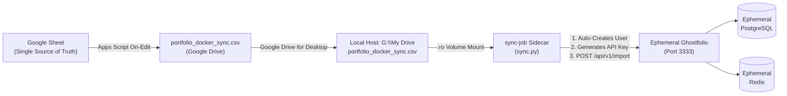

# Ephemeral Ghostfolio & Google Sheets Ingestion Pipeline

A decoupled, zero-cloud-API ingestion pipeline that turns **Ghostfolio into an on-demand ephemeral analytics engine**. The single source of truth is your Google Sheet CSV synced to Google Drive for Desktop.

---

## ⚡ 1-Command End-to-End Execution

Whenever you want to view your portfolio analytics, run one command:

```powershell
# In PowerShell (Windows):
.\start.ps1

# Or double-click / run in CMD:
start.bat
```

### What this single command does automatically:
1. **Generates ephemeral passwords in RAM**: Generates cryptographically random credentials for PostgreSQL, Redis, and Ghostfolio (`POSTGRES_PASSWORD`, `JWT_SECRET_KEY`, `ACCESS_TOKEN_SALT`). Zero secrets are written to disk.
2. **Verifies your synced trades CSV**: Directly checks `G:\My Drive\portfolio_docker_sync.csv` (or your configured `LOCAL_CSV_PATH`).
3. **Spins up the ephemeral container stack**: Launches `PostgreSQL`, `Redis`, and `Ghostfolio`.
4. **Polls readiness**: Waits until the Ghostfolio API (`/api/v1/health`) is fully initialized.
5. **Auto-provisions the user & exchanges API keys**: Automatically creates the user and default account via `POST /api/v1/user`, then exchanges the Security Token for an active Bearer API Key via `POST /api/v1/auth/anonymous`.
6. **Prints your credentials**:
   - `GHOSTFOLIO SECURITY TOKEN`: To log into the web browser UI.
   - `GHOSTFOLIO BEARER API KEY`: To make REST API calls via `curl`, Postman, or scripts.
7. **Parses & imports all trades**: The `sync-job` sidecar reads the mounted CSV (read-only), normalizes dates to UTC ISO 8601, and POSTs activities to `/api/v1/import`.
8. **Launches your default browser**: Opens `http://localhost:3333` directly to your populated portfolio.

---

## 🛑 1-Command Teardown & Ephemeral Cleanup

When you are done viewing your analytics:

```powershell
# In PowerShell (Windows):
.\cleanup.ps1

# Or double-click / run in CMD:
cleanup.bat

# For deep clean (also prunes built images and build cache):
.\cleanup.ps1 -Deep
```

### What the cleanup script destroys:
1. **Containers & Network**: Stops and removes `ghostfolio`, `postgres`, `redis`, and `sync-job`.
2. **Ephemeral Volumes**: Completely wipes PostgreSQL database storage and Redis cache (`docker compose down -v`).
3. **Lingering Docker Volumes**: Checks for and deletes any untracked project volumes.
4. **Local Temp Files & Cache**: Cleans up Python bytecode (`__pycache__`), temporary files, and logs.
5. **(Optional `-Deep`)**: Removes the built Docker sidecar image and builder cache.

**Your single source of truth remains completely safe in your Google Drive CSV.**

---

## 🏛 Architecture & Data Flow



---

## 📁 Repository Structure

```
ghostfolio-sheets-sync/
├── start.ps1                 # 1-Command end-to-end runner (PowerShell)
├── start.bat                 # 1-Click runner (Windows CMD)
├── start.sh                  # 1-Command runner (macOS / Linux)
├── cleanup.ps1               # Ephemeral teardown & storage wipe (PowerShell)
├── cleanup.bat               # 1-Click teardown & storage wipe (Windows CMD)
├── cleanup.sh                # Ephemeral teardown & storage wipe (macOS / Linux)
├── docker-compose.yml        # Ephemeral stack orchestration
├── .env.example              # Configuration template
├── .gitignore                # Git ignore rules (protects data & local files)
├── apps-script/
│   └── Code.gs               # (Already deployed) Sheet-to-Drive CSV exporter
└── sync-job/
    ├── Dockerfile            # Lightweight Python 3.11 container
    ├── requirements.txt      # requests, python-dateutil
    └── sync.py               # Auto-provisioning, key generation & CSV ingestion
```

---

## 🧪 Testing Dry-Run

You can verify the CSV parsing and see simulated credentials without starting Docker:

```powershell
.\start.ps1 -DryRun
```
